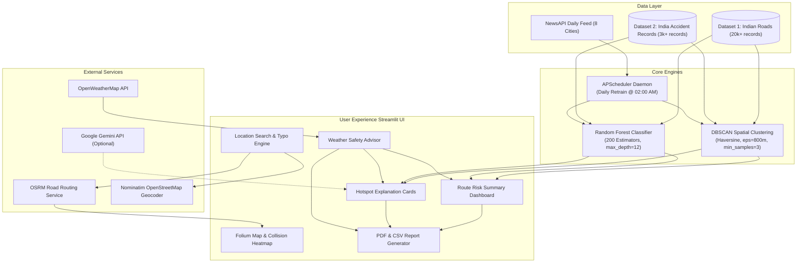

# SafeRoute AI — Road Accident Hotspot Prediction & Route Safety Analysis

[](https://www.python.org/)
[](https://streamlit.io/)
[](https://scikit-learn.org/)
[](https://python-visualization.github.io/folium/)
[]()

> **Proactive road safety intelligence that predicts high-risk accident hotspots, computes route safety scores, and delivers weather-aware defensive driving guidance along any travel corridor in India.**

---

## 1. Project Overview & Problem Statement

India accounts for over **150,000 road fatalities annually** — an urgent public safety challenge where many incidents can be avoided if drivers receive contextual risk warnings *before* entering hazardous zones.

Conventional navigation tools treat road hazard data as static, government-cataloged "black spots" that lack environmental adaptability, time-of-day awareness, or automated continuous learning. **SafeRoute AI** bridges this gap by merging historical accident density, machine learning risk classification, live weather context, and spatial clustering into an automated navigation companion.

---

## 2. Objectives & Motivation

1. **Transform Raw Accident Records into Proactive Warnings:** Convert tens of thousands of historical police and transport accident records into actionable intelligence.
2. **Dynamic Route Corridor Analysis:** Rather than showing all hazards nationally, scan only within a **500-meter threshold** of the user's real OSRM road geometry.
3. **Objective Route Safety Scoring:** Provide a transparent, distance-normalized **Route Safety Score (0–100)** to assist drivers, logistics operators, and fleet managers in evaluating corridor risks.
4. **Context-Sensitive Driving Recommendations:** Adapt safety guidance dynamically to active weather hazards (rain, fog, heavy crosswinds) and historical time-of-day risk patterns.
5. **Continuous Learning:** Ingest accident news automatically and retrain models daily via scheduled background jobs.

---

## 3. Key Features & Capabilities

### 🛡️ Route Risk Summary Dashboard
- **Route Safety Score (0–100):** A bounded, distance-normalized heuristic exposure index categorized into **Lower Relative Risk (80–100)**, **Moderate Relative Risk (60–79)**, and **Higher Relative Risk (0–59)**.
- **Visual KPI Grid:** Six real-time indicators covering Route Distance (km), Total Hotspots Detected, High Risk Zones, Medium Risk Zones, Low Risk Zones, and Route Midpoint Weather.
- **Plotly Risk Breakdown:** Interactive bar chart visualizing risk category distributions along the selected corridor.

### 📇 Hotspot Explanation Cards
- **Dual-Panel Architecture:**
  - **Panel 1 (Historical DBSCAN Intelligence):** Historical accident volume, fatalities, total casualties, primary recorded cause, peak accident window, and night collision percentage.
  - **Panel 2 (Environmental Context):** Live weather, temperature, wind speed, humidity, and road surface risk.
- **Interactive Card Selector:** Dropdown filter enabling drivers to isolate specific hotspots or view the complete corridor sequence.
- **Data Integrity:** Missing values cleanly display `"Not available"` — no fabricated statistics.

### 🌧️ Weather-Aware Driving Recommendations
- Condition-specific defensive driving precautions for rain/wet roads, fog/haze, high crosswinds, severe storms, and clear weather.
- **Corridor Risk Multiplier:** Automatically alerts the driver when adverse weather coincides with hotspots that historically recorded weather-related collisions.
- **Offline Fault-Tolerance:** Falls back to rule-based safety briefs when external weather or generative AI APIs are unavailable or unconfigured.

### 🗺️ Accident Hotspot Heatmap & Map Controls
- **Folium Interactive Map:** Real road geometry traced via Open Source Routing Machine (OSRM) with multi-layered neon glow styling.
- **Accident Density Heatmap:** Kernel density estimation layer generated from 20,000+ real collision coordinates, bounded to the route corridor for lag-free client rendering.
- **Layer Control:** Switch seamlessly between Positron Street and Esri World Imagery Satellite base tiles, with independent HeatMap toggles.

### 📄 Downloadable Route Safety Reports
- **Executive PDF Report:** Multi-page PDF report generated using ReportLab, containing SafeRoute branding, route summary metrics, weather assessment, complete hotspot inventory, and methodology disclaimers.
- **Structured CSV Export:** 15 structured fields per hotspot with standardized CSV metadata headers for audit and spreadsheet analysis.

### 🔍 City Autocomplete & Fuzzy Typo Correction
- Pre-indexed database of **50+ major Indian cities, state capitals, and industrial hubs**.
- Fuzzy matching via `difflib` automatically resolves common spelling mistakes (e.g., `banlgore` $\rightarrow$ `Bengaluru`, `Chenai` $\rightarrow$ `Chennai`, `Mumbay` $\rightarrow$ `Mumbai`).
- Interactive suggestion chips allow users to select corrections before scanning.

---

## 4. System Architecture



---

## 5. Technology Stack

| Layer | Component | Description |
| :--- | :--- | :--- |
| **Application Framework** | Streamlit 1.28+ | Reactive Python dashboard and user interface |
| **Machine Learning** | Scikit-Learn 1.2+ | Random Forest Classifier (severity) & DBSCAN (spatial clustering) |
| **Mapping & Geospatial** | Folium, Streamlit-Folium | Leaflet-based interactive maps, tile layers, and HeatMap plugin |
| **Routing & Geocoding** | OSRM, Nominatim | Real road coordinate paths and OSM geocoding with in-memory caching |
| **Reporting & Export** | ReportLab 4.0+ | Automated PDF safety report generation with vector styling |
| **Visualization** | Plotly 5.13+ | Interactive risk distribution bar charts and KPI metrics |
| **Live Context** | OpenWeatherMap API | Live ambient temperature, humidity, wind, and surface condition flags |
| **Safety Intelligence** | Google Gemini (optional) | AI-generated safety briefings with rule-based fallback logic |
| **Automation Daemon** | APScheduler | Background scheduler for daily automated retraining |
| **Data Processing** | Pandas, NumPy | Data cleaning, coordinate transformations, and vectorized Haversine math |

---

## 6. Project Structure

```
road-accident-hotspot-prediction/
├── app.py                      # Application entry point (multi-page redirect)
├── config.py                   # API configuration, city registry, system paths
├── requirements.txt            # Python package dependencies
├── .env.example                # Safe template for optional API keys
├── .gitignore                  # Git exclusions for environments, models, and caches
├── Dataset1 Folder/
│   └── indian_roads_dataset.csv       # 20,000+ GPS-tagged historical collisions
├── Dataset2 Folder/
│   └── accident_prediction_india.csv  # Supplementary Indian collision records
├── pages/
│   ├── Home.py                 # Platform landing page, stats, and pipeline docs
│   └── 5_Driver_Alert.py       # Core route safety analyzer and live dashboard
├── utils/
│   ├── hotspot_engine.py       # DBSCAN clustering & collision density extractor
│   ├── risk_model.py           # Random Forest training and risk classification
│   ├── route_analyzer.py       # OSRM road routing & 500m Haversine corridor filter
│   ├── route_safety.py         # Route Safety Score algorithm & recommendations
│   ├── weather_advisor.py      # Weather rules engine & corridor hazard multipliers
│   ├── location_service.py     # 50+ city registry, fuzzy typo correction, caching
│   ├── report_generator.py     # Multi-page ReportLab PDF and CSV report builders
│   ├── ai_description.py       # OpenWeatherMap client & Gemini / rule-based briefs
│   ├── auto_retrain.py         # APScheduler daily news retrain daemon
│   ├── news_fetcher.py         # NewsAPI scraper and NLP feature extractor
│   └── ui_components.py        # Global neon CSS styles, badges, and top navigation
├── assets/
│   ├── images/                 # Platform branding, icons, and logo assets
│   └── styles/                 # Custom CSS stylesheet
├── sample_data/
│   ├── hotspots.pkl            # Pre-indexed DBSCAN cluster cache (1,126 clusters)
│   ├── risk_model.pkl          # Serialized Random Forest model artifact
│   └── retrain_log.json        # Daemon training logs and accuracy history
└── tests/
    ├── test_features.py        # Unit test suite covering all core features (26 tests)
    ├── test_e2e.py             # End-to-end integration test (Chennai -> Bangalore)
    └── test_typos.py           # Verification script for fuzzy location matching
```

---

## 7. Machine Learning & Mathematical Methodology

### 1. Risk Classification (Random Forest)
A **Random Forest Classifier** (`n_estimators=200`, `max_depth=12`, `class_weight='balanced'`) predicts collision severity ($\text{Severity} \ge 2$, denoting major or fatal accidents).
- **Features:** `latitude`, `longitude`, `hour`, `weather` (encoded), `road_type`, `traffic_density`, `visibility`, `is_peak_hour`, `vehicles_involved`, and `risk_score`.
- **Output:** Continuous probabilistic risk estimate classified into **HIGH** ($\ge 0.60$), **MEDIUM** ($\ge 0.35$), or **LOW** ($< 0.35$).

### 2. Spatial Hotspot Clustering (DBSCAN)
Unsupervised spatial clustering applies DBSCAN using the **Haversine metric** ($\epsilon = 800\text{ meters}$, $\text{min\_samples} = 3$ points) on historical GPS coordinates.
- **Clusters Identified:** 1,126 dense collision zones identified across India.
- **Cluster Intelligence:** Each cluster indexes total collisions, fatal count, casualties, primary recorded cause, peak accident hour, and night incident ratio.

### 3. Route Corridor Scanning
Given road geometry coordinates $R = \{r_1, r_2, \dots, r_m\}$ from OSRM and hotspot centroids $H = \{h_1, h_2, \dots, h_k\}$, vectorized Haversine distance computes:
$$d(r_j, h_i) = 2R \arcsin\left(\sqrt{\sin^2\left(\frac{\Delta\phi}{2}\right) + \cos\phi_1\cos\phi_2\sin^2\left(\frac{\Delta\lambda}{2}\right)}\right)$$
Only clusters where $\min_{j} d(r_j, h_i) \le 500\text{ meters}$ are flagged as route alerts.

### 4. Route Safety Score Heuristic
The safety score quantifies cumulative corridor hazard exposure normalized by total travel distance:
$$\text{Exposure Density} = \frac{\sum_{i=1}^{N} w_i \times \text{offset\_penalty}_i}{\max(\text{Distance}_{\text{km}}, 1.0)} \times 100$$
$$\text{Route Safety Score} = \text{round}\left(100 \times \exp\left(-\frac{\text{Exposure Density}}{20}\right)\right)$$
- $w_{\text{HIGH}} = 3.0$, $w_{\text{MEDIUM}} = 1.5$, $w_{\text{LOW}} = 0.5$
- $\text{offset\_penalty}_i = 1.0$ for hotspots within 250m; graded linearly between 250m and 500m.

> *Notice: The Route Safety Score is an advisory heuristic indicator based on historical density exposure and does not represent a statistical guarantee of collision probability.*

---

## 8. Prerequisites & Installation

### Prerequisites
- Python **3.10, 3.11, 3.12, or 3.13**
- Git 2.x
- Internet connection (for Nominatim geocoding and OSRM routing)

### Installation Steps

1. **Clone the Repository:**
   ```bash
   git clone https://github.com/deepakcvram/smart_route.git
   cd smart_route
   ```

2. **Create and Activate a Virtual Environment:**
   ```bash
   # Windows (PowerShell)
   python -m venv venv
   .\venv\Scripts\Activate.ps1

   # Linux / macOS
   python3 -m venv venv
   source venv/bin/activate
   ```

3. **Install Dependencies:**
   ```bash
   pip install --upgrade pip
   pip install -r requirements.txt
   ```

---

## 9. Environment Configuration

The application runs completely out-of-the-box with intelligent offline fallbacks. To enable live weather updates, automated news ingestion, or generative AI briefs, copy `.env.example` to `.env`:

```bash
cp .env.example .env
```

Edit `.env` with your personal API keys:
```env
OPENWEATHER_KEY=your_openweathermap_api_key_here
NEWSAPI_KEY=your_newsapi_key_here
GEMINI_KEY=your_gemini_api_key_here
```

*(Note: API keys can alternatively be placed directly in `config.py`).*

---

## 10. Running the Application

Launch the Streamlit web dashboard:
```bash
streamlit run app.py
```

Once started, navigate to:
```
Local URL: http://localhost:8501
```

### Usage Instructions
1. Open the sidebar navigation and select **5 Driver Alert**.
2. Enter your origin city (e.g., `Chennai`) or click a quick-select chip.
3. Enter your destination (try entering a typo like `banlgore`).
4. Select the suggested city chip (`👉 Use Bengaluru`) or click **SCAN ROUTE**.
5. Inspect the Route Safety Score, KPI grid, and Plotly risk chart.
6. Explore the interactive Folium map and toggle the **Accident Density Heatmap**.
7. Examine the **Hotspot Explanation Cards** using the card filter selector.
8. Click **📄 Download PDF Safety Report** or **📊 Download CSV Data Export** to save your report.

---

## 11. Testing & Verification

The project includes unit and end-to-end test suites:

### Running Unit Tests
```bash
python -m unittest tests.test_features
```
**Results:** `Ran 26 tests in 0.370s — OK`
- Covers route distance calculations, score boundary conditions, cluster deduplication, weather fallback handling, fuzzy typo resolution, and PDF/CSV generation.

### Running End-to-End Pipeline Test
```bash
python tests/test_e2e.py
```
**Results:** `ALL E2E PIPELINE CHECKS PASSED SUCCESSFULLY!`
- Loads 1,126 trained clusters, queries OSRM for a 327.3 km corridor between Chennai and Bangalore, scans 8 corridor hotspots, computes safety metrics, and verifies Plotly chart and report builders.

---

## 12. Example Inputs & Outputs

### Input
- **Origin:** `Chennai, Tamil Nadu`
- **Destination:** `Bangalore, Karnataka` (or `banlgore`)

### Output Summary
- **Corridor Distance:** `327.3 km` (4,771 road path coordinates)
- **Detected Hotspots:** `8 hotspots` within 500m of the roadway
- **Route Safety Score:** `68 / 100` (`MODERATE RELATIVE RISK`)
- **Severity Breakdown:** 0 High · 8 Medium · 0 Low
- **Report Outputs:** Generated `SafeRoute_Report_Chennai_to_Bangalore.pdf` and `SafeRoute_Data_Chennai_to_Bangalore.csv`

---

## 13. Known Limitations & Troubleshooting

- **Geocoding Latency:** Nominatim enforces a strict rate limit of 1 request/second. SafeRoute AI utilizes in-memory caching and a local 50+ city database to minimize network queries.
- **Routing Dependency:** Route geometry requires an active connection to public OSRM servers (`router.project-osrm.org`). If unreachable, check your internet connectivity.
- **Live Weather Offline:** If no OpenWeatherMap key is configured in `.env`, the dashboard cleanly flags weather as offline and uses standard defensive driving rules without fabricating data.

---

## 14. Roadmap & Future Improvements

- [ ] Mobile companion PWA with turn-by-turn voice alerts when within 1 km of a hotspot.
- [ ] Integration with Google Navigation / Android Auto via custom intent routing.
- [ ] Multi-route comparative analysis (e.g., comparing NH48 vs. state highways for safety score).
- [ ] Crowdsourced hazard feedback loop with automated moderation.

---

## 15. Contribution Guidelines

Contributions are welcome! To contribute:
1. Fork the repository.
2. Create a feature branch: `git checkout -b feature/AmazingFeature`.
3. Commit your changes: `git commit -m 'Add AmazingFeature'`.
4. Push to the branch: `git push origin feature/AmazingFeature`.
5. Open a Pull Request.

---

## 16. Author & Contact

- **Repository:** [deepakcvram/smart_route](https://github.com/deepakcvram/smart_route)
- **Author:** [deepakcvram](https://github.com/deepakcvram)
- **Project Link:** `https://github.com/deepakcvram/smart_route`

---

*SafeRoute AI is built for defensive driver awareness and road risk analysis. Drive responsibly and always adhere to local traffic laws.*
